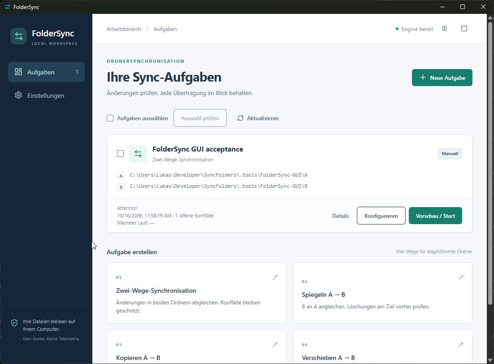

# FolderSync

A Windows x64 desktop folder synchronizer built with Rust and Tauri 2. React presents tasks and immutable previews; Rust owns every filesystem operation. This is an unsigned Windows release. See [actual QA results](docs/product/qa-report.md) before using valuable files.

## Why FolderSync — and how fast is it?

FolderSync connects two folders accessible from one Windows PC: a local working directory and another local, USB or UNC folder. Use it when you want offline editing, explicit review of differing files and recoverable replacements without a cloud account. Rust owns the filesystem work; Tauri supplies the native Windows shell.

After initial indexing, Windows file events drive incremental discovery. A normal single-file change reads that path on both sides and updates its cached ancestors; it does not hash the entire folder tree. Missed events, restart or an uncertain/unavailable root require reconciliation. Manual Preview and the optional Full content comparison intentionally verify both complete trees.

Measured on this machine with the debug engine, 10,000 files per side (1 KiB each), release 0.1.1 source f13b9bc:

| Discovery | Time | Entries examined | Bytes hashed |
|---|---:|---:|---:|
| Initial | 31.7 s | 20,200 | 20,480,000 |
| Single-file event | 150 ms | 2 | 2,048 |
| Forced full | 33.5 s | 20,200 | 20,480,000 |

Native event through Apply took 340 ms before the configured debounce; peak working set was 55.3 MiB. These are measurements, not a throughput guarantee for your disk or SMB server. [Raw results and methodology](docs/product/benchmarks/latest.json). Real SMB transfer/reconnection remains unverified on this machine because creating the dedicated disposable share was denied. An unavailable UNC was rejected without changing local files.

## Install and run

Run `target\release\bundle\nsis\FolderSync_0.1.6_x64-setup.exe`. The NSIS installer targets the current user, with no service or administrator requirement. Microsoft Edge WebView2 Runtime is required; the Tauri installer can provision it when missing. This machine already has it. No signing certificate is configured.

The optional installer checkbox **Start FolderSync in the tray when I sign in** registers only the current account. It is unchecked for a new install. Silent installation supports `/S /STARTUP=1` or `/S /STARTUP=0`; omitting the option preserves an existing registration. Settings offers the same option. Sign-in uses the quoted installed executable with `--background`, loads saved configuration and leaves the window hidden. Installing or enabling startup does not enable any task, watch, schedule or deletion policy. Previously enabled task triggers still run when FolderSync starts. Uninstall removes its sign-in entry and retains saved data unless you explicitly request removal.

Create a task with two existing writable folders, choose the direction, then Preview. Different pre-existing bytes produce a conflict. Selecting a conflict direction only revises the preview. Apply requires a separate confirmation; every manual removal also needs approval of the exact plan. By default, existing file contents are protected in `%APPDATA%\FolderSync\versions\<task UUID>`. Per-task **Keep file versions** can be switched OFF: ordinary updates/deletions then retain no previous contents. Existing versions remain available; unexpected/disrupted replacement can retain emergency copies. Restore active-task versions through Tasks → Details → Protected versions; sidebar Recovery lists versions from deleted tasks.

Closing the window leaves the process running in the tray by default. Settings can instead make Close stop work safely and quit; unsaved task drafts require confirmation. Reopen with the shortcut or executable; single-instance handling shows the existing window. Quit from Settings or the tray stops the process. Triggers are off on new/imported/duplicated tasks. Only enable monitoring after checking the first manual result.

## Implemented

- Two-way, copy, mirror and verified move; baseline-aware conflicts and protected deletions.
- Persistent tasks with editable IDs, groups, duplication, own versioned JSON import/export, native directory picker.
- Scope globs, selected folders, hidden/system filters, filter tester, Unicode/long paths.
- Immutable Preview/Apply, conflict choices, stale-input rejection, history and reviewed restore, including deleted-task recovery.
- Native Windows notifications for filesystem changes, persistent dirty paths and incremental ancestor hashes.
- Calendar/periodic schedules, bounded retries/debounce/bandwidth, pause/cancel, close-to-tray.
- Incremental or full content verification; preserve-and-continue or hold-until-reviewed conflict policy.
- Configurable 1–4 verified file transfers sharing a total bandwidth cap, with cancellation and crash recovery; default one transfer.
- English/German principal screens, expandable/copyable full folder paths, local optional operation logs, no telemetry/account/cloud service.

Automatic deletion defaults off. After a successful full manual reconciliation, two-way/mirror tasks can explicitly opt into proven baseline deletion within both per-run entry and percentage limits. Unknown deletions and Move still stop for review; see [policy details](docs/product/automatic-deletion.md). Roots and mode of an established task require a new task; this prevents carrying a baseline into a different folder pair. Recovery copies are ordinary file content, not an ACL/alternate-stream backup system. An actual unavailable UNC was safely rejected. Creating the dedicated disposable SMB share was denied to this account, so real SMB transfers, disconnect/reconnect and network notification behavior are unverified. Use a stable UNC path and manually review the first result. Actual OS sign-in, notification activation/deep links, high-DPI and comprehensive fault coverage remain unverified; see QA for the full list.



## Develop

Install Rust stable MSVC, Visual Studio C++ Build Tools plus Windows SDK, Node and pnpm. PowerShell scripts also detect this Codex environment's bundled Node/pnpm. TLS verification stays enabled using Windows system trust.

```powershell
./scripts/dev.ps1
./scripts/verify.ps1
./scripts/benchmark.ps1
./scripts/package.ps1
```

`cargo test --workspace` runs real disposable filesystem fixtures, including subprocess termination during copy. `pnpm test` includes the frontend preview/conflict/confirmation boundary. Benchmarks create conspicuously named synthetic folders in the OS temp directory; no company paths are used. Full initial/verification scans hash every file; a confirmed single-file event hashes only affected entries.

Read [architecture](docs/product/architecture.md), [semantics](docs/product/sync-semantics.md), and [reference mapping](docs/product/reference-matrix.md). Original SyncFolder research remains untouched under `docs/syncfolders-research`; no proprietary assets or formats are incorporated.


## Local data, filters and notifications

Current data folder: `%APPDATA%\FolderSync`; application identifier: `dev.lukas.foldersync`. The first updated launch copies the old identifier folder into the new location with a consistent SQLite snapshot and preserves the old folder as a fallback. Close the old application first. After switching, do not run an older FolderSync executable: the retained legacy directory is a recovery snapshot and later legacy edits are not merged. Ambiguous or interrupted migrations stop with an error rather than merge databases. Existing catalogued backups are also regrouped into task subfolders during migration. Protected files use one subfolder per task and version UUID filenames; Details → Protected versions maps them to their original names. Legacy flat backups remain restorable. Retention is configurable, so recovery storage is not an unlimited archive.

The dashboard offers persistent Tiles/List views. Selecting tasks exposes Disable/Delete in the header. Disable turns off automatic triggers and clears pending automatic work; manual Preview stays available. Delete removes task configuration and its sync baseline after confirmation, preserving A/B files and protected recovery copies.

[Filter help and examples](docs/help/filters.md) are also bundled in the app. Empty-field examples are placeholders, never active settings. The repository has no remote URL yet; see [TODO.md](TODO.md).

Settings → Version shows the installed version; an automatic updater is not configured. Notification delivery now requests the default Windows sound. Settings shows Windows delivery permission and offers a test notification. Banner display, sound suppression and Do not disturb remain Windows-controlled; a successful send does not prove a banner appeared. No OS notification/privacy settings are changed by the application.
